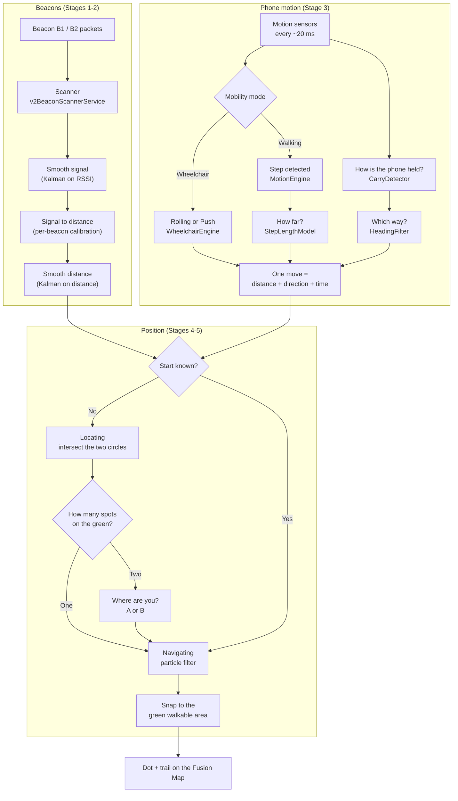
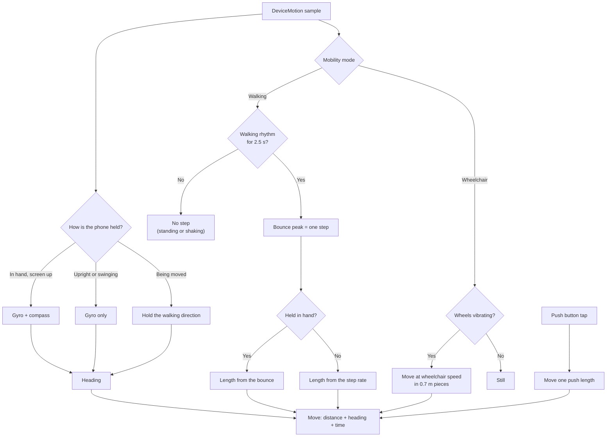
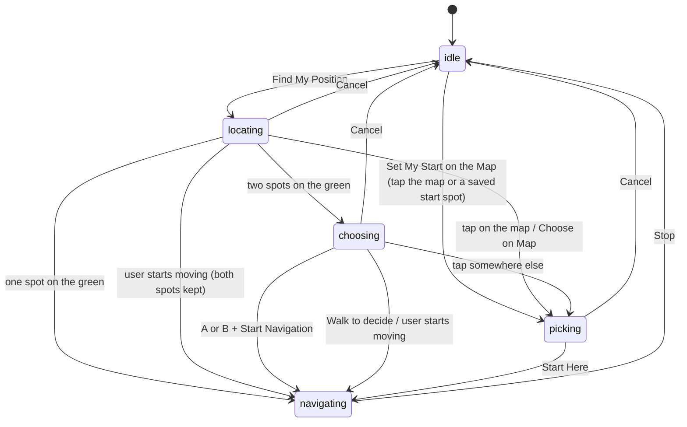
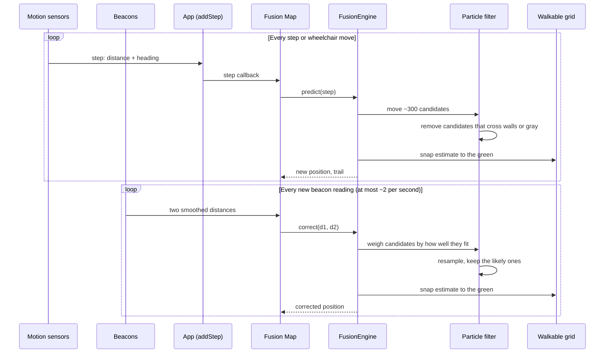

# End-to-End Flow: from the signal to the navigation dot

Written for: anyone who needs to follow what happens, in order, from the moment the phone hears a beacon to the moment the dot moves on the map. The maths is left out on purpose. See `project-context.md` for the numbers and `logic.md` / `architecture.md` for the older engine.

---

## The big picture

The app answers one question all the time: **"Where is the user on the floor plan right now?"**

It uses two kinds of information:

1. **Beacons (BLE)**: the phone hears two beacons and estimates how far it is from each. This tells the app roughly _where_ the user is, but it is noisy, especially through walls.
2. **Phone motion (PDR)**: the phone's sensors notice each step, how long it is, and which way the user is facing. This tells the app how the user _moves_, but it drifts over time.

Beacons correct the drift. Motion fills the gaps between beacon readings. A map-matching step keeps the dot on the walkable (green) part of the floor plan.

### End-to-end at a glance

---

## Stage 1: the phone hears the beacons

1. The phone's Bluetooth scanner (`services/v2BeaconScannerService.js`) listens continuously for packets from the two beacons.
2. Each packet carries a **signal strength** (RSSI). Stronger signal usually means closer, but walls, pillars and people weaken it.
3. The scanner keeps packets in **two slots**, one for each beacon, and tracks how many packets arrived.

## Stage 2: from signal strength to a distance

This happens in `services/SimpleRanging.js`, shown on the Raw and Fusion Map screens. B1 and B2 are chosen on the Raw tab.

1. **Smooth the signal.** A Kalman filter on the raw signal strength removes the packet-to-packet jitter.
2. **Convert to a distance.** Each beacon has its own calibration: the strength measured at 1 m, and an environment factor (how much walls and furniture weaken the signal).
3. **Smooth the distance.** A second Kalman filter smooths the distance, because a small change in signal means a large change in distance far from the beacon.
4. **Output:** a distance for each beacon, plus an uncertainty. Far beacons are trusted less.
5. **How old it is.** Smoothing makes the distance trail behind: it describes where the user was about 1–2 seconds ago near a beacon, and 3–4 seconds ago far from it. This lag is worked out from the filters and passed on with the distance.

If a beacon goes silent for about 5 seconds, its filters restart, so an old reading is not carried into a new place.

## Stage 3: the phone feels the motion

This happens on every motion sample, about every 20 ms, in `App.android.js` / `App.ios.js`.

### 3a. How is the phone being held?

`services/CarryDetector.js` decides from gravity whether the phone is:

- **in hand**, screen roughly up;
- **upright**, at the ear or in a chest pocket;
- **swinging**, in a swinging hand or a trouser pocket.

It also notices when the phone is being **moved** from one position to another, for example being put into a pocket. A hand swinging hard is not mistaken for a move: what counts as a move is measured against how far the phone has been swinging anyway.

### 3b. Is the user walking, and did they take a step?

`services/MotionEngine.js` looks at the up-and-down bounce of the phone.

1. It waits until the bounce repeats at a walking rhythm (it checks the last 2.5 seconds; walking is usually confirmed 2–3.5 seconds after starting). Shaking the phone does not produce a steady rhythm, so it is not counted.
2. Once walking is confirmed, the steps taken while it was checking are added at once, each with its own time and direction. With the phone in a trouser pocket the far leg's step is often too weak to see, so a gap of exactly two steps counts the missing one.
3. From then on, each bounce peak is one **step**, counted straight away. A knock or a jolt (far stronger than the steps) is not counted, and does not hide the steps after it.
4. A swinging limb is recognised by its back-and-forth rotation, so a swinging hand or pocket still counts steps.

### 3c. Which way is the user facing?

`services/HeadingFilter.js` keeps the heading.

- The **gyroscope** follows every turn, in any carry position.
- The **compass** is used only when the phone is held in front, because upright or swinging the compass angle is meaningless. It only corrects slow drift.
- While the phone is being moved, the heading is **held** at the direction the user was walking, so putting the phone in a pocket does not turn the user. If the phone ends up back where it was (the wrist only tilted it during a turn), the turn made meanwhile is kept.
- Each step gets the **average** heading over that stride, which removes the sway.

### 3d. How far did the user step?

`services/StepLengthModel.js` gives the length of each step.

- **In hand:** from the strength of the bounce.
- **Pocket, swinging or ear:** from the step rate, using the ratio learned during in-hand walking.
- A **calibration walk** of a known distance sets the personal scale for everyone's phone and gait.

### 3e. Wheelchair mode (instead of steps)

A wheelchair user makes no steps, so Stage 3b finds nothing. With **Wheelchair** mode on (switch on the PDR tab or Fusion Map), `services/WheelchairEngine.js` replaces the step detector:

- **Rolling:** the wheels make the phone buzz. While that vibration lasts, the user moves forward at their wheelchair speed, handed over as 0.7 m moves. Picking up or using the phone and spinning on the spot add no distance.
- **Push button:** each tap of **♿ Push** on the Fusion Map moves the user one push length. This is what works on carpet, where the wheels barely vibrate.
- **Calibration** (Settings): roll a measured distance to set the speed, or tap Push once per push to set the push length.
- Direction still comes from the gyroscope (3c), and map matching allows more doubt about the distance than for counted steps.

**Output of this stage:** one step (or wheelchair move) = _how far_ + _which way_ + _when_.

## Stage 4: finding the start (locating)

The Fusion Map begins in the **`idle`** phase. When the user starts, it moves to **`locating`**.

1. The user stands still while the distance readings arrive.
2. `services/FusionEngine.js` collects them. Each beacon's distance is a circle around the beacon.
3. `services/InitialPositionSolver.js` finds where the two circles cross.
4. **Two beacons always leave two crossing points**, one on each side of the line between them. Both fit the signal equally well, so the app needs a way to choose.
5. **Floor plan check:** any crossing point that lies on gray, a cabin or outside the room is removed. Often this leaves only one point.
6. If two points remain, the app moves to **`choosing`** and shows a **"Where are you?"** card with the two spots labelled **A** and **B** on the map.
   - The user taps A or B (on the map or with the "I'm at A / B" buttons), then presses **Start Navigation**. Only the chosen side is kept.
   - **Walk to decide** starts navigating with both spots; the first steps, the walls and the beacons settle which one is right.
   - Tapping somewhere else on the map means "I am somewhere else": that spot becomes the start.
   - Moving without pressing anything starts navigation with the spot picked so far, or with both if none was picked.
   - Beacon readings are paused while the user chooses, so neither spot is dropped behind their back.
7. If one point remains, the app takes it as the start position.
8. Walking during locating ends it early. There is no time to ask, so both spots are kept and the walk decides.

**Fusion Map phases:**

While the position is being found, and for a few seconds after while the first beacon corrections still move it, the map shows a searching animation instead of a jumping dot. The dot appears once the position holds still, when you take a step, or after 15 seconds.

## Stage 5: navigating

Once the start position is known, the app moves to **`navigating`**. Every step and every beacon reading now updates the position.

### 5a. On each step (motion → position)

1. The step (length, heading) is passed from the app to the Fusion Map through the step callback.
2. The **particle filter** (`services/ParticleFilter.js`, called "Map Matching") moves about 300 candidate positions, each with its own small error in step length and heading.
3. Any candidate that would cross a wall, a pillar, a no-walk area, the room edge or gray is removed.
4. The position is the average of the surviving candidates.
5. The walked trail is recorded and the dot moves. Beacon corrections while standing still never draw track.

If Map Matching is turned off, the older **EKF** (Extended Kalman Filter) does the same job without the candidate cloud. It is less accurate near walls.

### 5b. On each beacon reading (distance → position)

1. The two smoothed distances from Stage 2 arrive, each with how old it is.
2. The particle filter gives candidates a weight: those whose distances to the two beacons match the readings get more weight. Each candidate is checked at **where it was when the reading was taken** (its position minus its own moves since then), not where it is now. Without this, the old readings pulled the dot back while walking and made it learn that the steps were shorter than they are. Readings that are far off are treated as possible outliers.
3. Candidates that are consistent with the readings survive. The estimate moves toward them.
4. Beacon readings are used at most about twice a second, and less while the user is still, so the dot does not jitter.

### 5c. Keeping the dot on the map

Every position that leaves the filter is **snapped to the nearest green point** of the floor plan, from `services/WalkableGrid.js`. Taps on the map and the start position are snapped the same way.

### 5d. Showing the result

The Fusion Map shows the dot, the trail, a Map Matching status line, and a "📱 Phone:" line with the detected carry mode. The PDR tab shows the step length, cadence and "Not walking" reasons.

---

## Stage 6: the loop

After the start, the app keeps repeating Stages 3 to 5:

Steps move the dot forward. Beacons pull it back to where the signal says the user is. The floor plan stops it from going through walls or into cabins.

---

## Where to look in the code

| Stage                | Main file                                                                                                                                                                           |
| -------------------- | ----------------------------------------------------------------------------------------------------------------------------------------------------------------------------------- |
| 1. BLE packets       | `services/v2BeaconScannerService.js`                                                                                                                                                |
| 2. Signal → distance | `services/SimpleRanging.js`                                                                                                                                                         |
| 3. Motion            | `App.android.js`, `App.ios.js`, `services/CarryDetector.js`, `services/MotionEngine.js`, `services/HeadingFilter.js`, `services/StepLengthModel.js`, `services/WheelchairEngine.js` |
| 4. Locating          | `services/FusionEngine.js`, `services/InitialPositionSolver.js`                                                                                                                     |
| 5. Navigating        | `services/ParticleFilter.js`, `services/FusionEngine.js`, `services/WalkableGrid.js`                                                                                                |
| Screen               | `components/v2/FusionMapScreen.js`                                                                                                                                                  |
| Test recording       | `services/TestRecorder.js`                                                                                                                                                          |

## Known gaps in this flow

- **Wheelchair rolling threshold is untuned:** the vibration level that means "rolling" was set without a real wheelchair recording. On carpet, rolling is not detected and the Push button is needed.
- **Start in a pocket:** the heading at the start is unknown until the phone is held in front.
- **Not yet tested on a phone:** the flow above was checked in simulation and on the floor-plan grid only.
